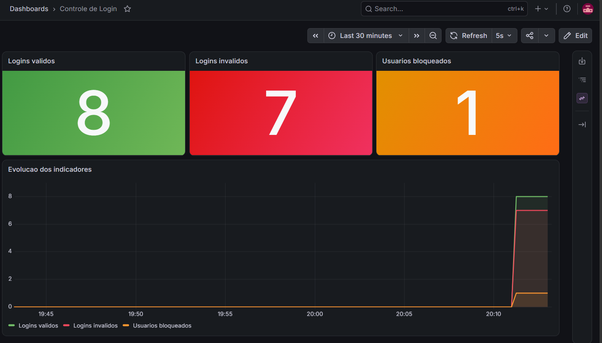

# MS-AV-02 - Segurança e Observabilidade

Mecanismo de login RESTful em **Spring Boot** com controle de acesso por *roles* (`JdbcUserDetailsManager`), bloqueio de usuários após falhas de login, indicadores no **Actuator/Prometheus**, dashboard no **Grafana** e documentação **OpenAPI/Swagger**.

Implementado seguindo o padrão do repositório da disciplina: [esensato/ms-2026-02](https://github.com/esensato/ms-2026-02).

## Tecnologias

| Item | Uso |
| --- | --- |
| Spring Boot 3.5 / Java 17 / Maven | base do serviço |
| Spring Security + `JdbcUserDetailsManager` | autenticação HTTP Basic e *roles* |
| Spring Data JPA + H2 (memória) | tabelas `usuarios` e `login_attempts` |
| Actuator + Micrometer + Prometheus | indicadores |
| Grafana | dashboard |
| springdoc-openapi | documentação OpenAPI e Swagger UI |

## Estrutura

```
src/main/java/aula/microservicos/seguranca
├── config/        SecurityConfig (JdbcUserDetailsManager + roles), OpenApiConfig
├── controller/    UsuarioController (end-points)
├── dto/           LoginRequest, TrocaSenhaRequest, UsuarioResponse, MensagemResponse
├── entity/        UsuarioEntity (usuarios), LoginAttemptEntity (login_attempts)
├── exception/     exceções de negócio + GlobalExceptionHandler
├── metrics/       LoginMetricas (counters e gauge)
├── repository/    UsuarioRepository, LoginAttemptRepository
└── service/       UsuarioService (regras de login, bloqueio, troca de senha)
src/main/resources
├── application.properties
├── schema.sql     tabelas do enunciado + tabelas do JdbcUserDetailsManager
└── data.sql       operadores, roles e usuários de exemplo
docker-compose.yml, prometheus/, grafana/   observabilidade
scripts/gerar-trafego.sh                    gera logins para popular o dashboard
```

## Modelo de dados

- **`usuarios`** e **`login_attempts`**: exatamente como no enunciado. A única alteração foi remover a vírgula sobrando após `updated_at`, que gerava erro de sintaxe.
- **`users`** e **`authorities`**: *schema* padrão do `JdbcUserDetailsManager`. Guarda os operadores que acessam os end-points protegidos:

| Operador | Senha | Role |
| --- | --- | --- |
| `admin` | `admin` | `ROLE_ADMIN` |
| `manutencao` | `manutencao` | `ROLE_MANUTENCAO` |

Usuários de exemplo na tabela `usuarios`: `joao/123456` e `maria/abc123`.

## End-points

| Método | Caminho | Acesso | Corpo | Respostas |
| --- | --- | --- | --- | --- |
| POST | `/login` | público | `{"username":"","senha":""}` | 200 válido · 401 inválido ou bloqueado |
| PUT | `/trocarsenha/{userid}` | público | `{"atual":"","nova":""}` | 200 · 400 nova senha inválida · 401 senha atual inválida ou bloqueado · 404 |
| POST | `/` | `ROLE_MANUTENCAO` | `{"username":"","senha":""}` | 201 · 400 · 401 · 403 · 409 já existe |
| PUT | `/unlock/{userid}` | `ROLE_ADMIN` | - | 200 · 401 · 403 · 404 |
| GET | `/` | `ROLE_MANUTENCAO` | - | 200 lista em JSON · 401 · 403 |

Os end-points protegidos usam autenticação **HTTP Basic** (header `Authorization: Basic ...`).

### Regra de bloqueio

"Caso o usuário falhe mais de uma vez no login ele deve ser bloqueado":

1. Cada senha incorreta incrementa `failed_attempts` e grava `last_failed_at`.
2. Na **segunda falha consecutiva**, `locked = TRUE` e `locked_at` são gravados.
3. Usuário bloqueado recebe **401** mesmo informando a senha correta.
4. Um login válido zera `failed_attempts`.
5. `PUT /unlock/{userid}` volta `locked = FALSE` e zera as tentativas.

## Indicadores

Expostos em `http://localhost:8080/actuator/prometheus`:

| Métrica Micrometer | Nome no Prometheus | Tipo | Origem |
| --- | --- | --- | --- |
| `login.validos` | `login_validos_total` | counter | incrementado a cada login válido |
| `login.invalidos` | `login_invalidos_total` | counter | incrementado a cada login inválido |
| `usuarios.bloqueados` | `usuarios_bloqueados` | gauge | `COUNT(*)` de `login_attempts` com `locked = TRUE` |

## Como executar

### 1. Aplicação

```bash
mvn spring-boot:run
```

Ou pelo VS Code (Spring Boot Dashboard). Para rodar os testes: `mvn test`.

| Recurso | URL |
| --- | --- |
| Swagger UI | http://localhost:8080/swagger-ui.html |
| OpenAPI (JSON) | http://localhost:8080/v3/api-docs |
| OpenAPI (YAML) | http://localhost:8080/v3/api-docs.yaml |
| Prometheus endpoint | http://localhost:8080/actuator/prometheus |
| Console H2 | http://localhost:8080/h2-console (JDBC URL `jdbc:h2:mem:segurancadb`, usuário `sa`, senha `password`) |

No Swagger, use o botão **Authorize** com `admin/admin` ou `manutencao/manutencao` para testar os end-points protegidos.

### 2. Prometheus e Grafana

```bash
docker compose up -d
```

| Serviço | URL | Acesso |
| --- | --- | --- |
| Prometheus | http://localhost:9090/targets | o alvo `seguranca` deve estar **UP** |
| Grafana | http://localhost:3000 | `admin/admin` |

O datasource e o dashboard **Controle de Login** são carregados automaticamente (pasta `grafana/`).

### 3. Gerar dados para o dashboard

```bash
./scripts/gerar-trafego.sh
```

## Exemplos com curl

```bash
# login válido (200) e inválido (401)
curl -i -X POST http://localhost:8080/login -H "Content-Type: application/json" -d '{"username":"joao","senha":"123456"}'
curl -i -X POST http://localhost:8080/login -H "Content-Type: application/json" -d '{"username":"joao","senha":"errada"}'

# troca de senha
curl -i -X PUT http://localhost:8080/trocarsenha/joao -H "Content-Type: application/json" -d '{"atual":"123456","nova":"nova123"}'

# cadastro (ROLE_MANUTENCAO)
curl -i -u manutencao:manutencao -X POST http://localhost:8080/ -H "Content-Type: application/json" -d '{"username":"pedro","senha":"senha1"}'

# listagem (ROLE_MANUTENCAO)
curl -i -u manutencao:manutencao http://localhost:8080/

# desbloqueio (ROLE_ADMIN)
curl -i -u admin:admin -X PUT http://localhost:8080/unlock/joao
```

## Dashboard Grafana



O dashboard exportado está em [`grafana/dashboard-exportado.json`](grafana/dashboard-exportado.json).
